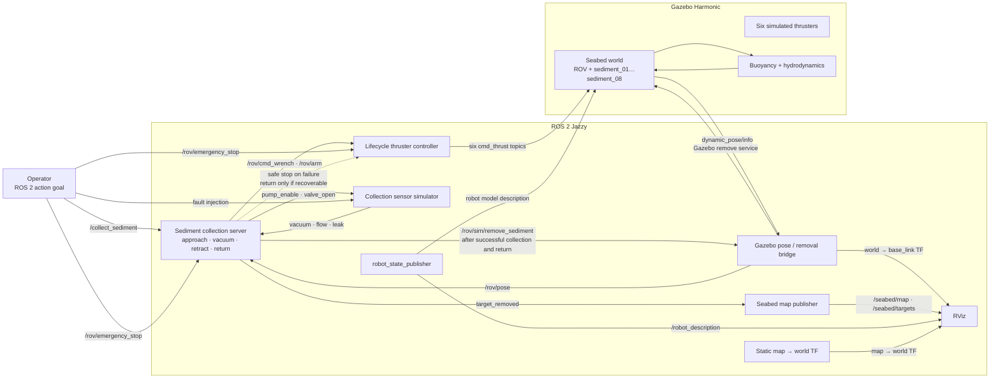
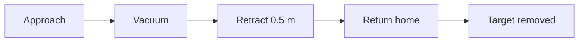

<div align="center">

# ROV Sediment Collector

**A six-thruster underwater ROV with a simulated vacuum sediment sampler**
built for **ROS 2 Jazzy** and **Gazebo Harmonic**


[Quick Start](#quick-start) · [Demo](#sediment-collection-demo) · [Architecture](#system-architecture) · [Teleop](#keyboard-teleop) · [Collection](#sediment-collection) · [Fail-safes](#fail-safe-tests) · [Parameters](#parameter-reference)

</div>

---

## Table of Contents

1. [Overview](#overview)
2. [Sediment collection demo](#sediment-collection-demo)
3. [Safety and fidelity notice](#safety-and-fidelity-notice)
4. [Quick start](#quick-start)
5. [Seabed collection scene](#seabed-collection-scene)
6. [System architecture](#system-architecture)
7. [Thruster control interface](#thruster-control-interface)
8. [Keyboard teleop](#keyboard-teleop)
9. [Sediment collection](#sediment-collection)
10. [Fail-safe tests](#fail-safe-tests)
11. [Parameter reference](#parameter-reference)
12. [Physics model](#physics-model)
13. [Debugging](#debugging)

---

## Overview

| Package | Purpose |
|---|---|
| `rov_description` | Xacro model, sensor frames, six vectored thruster frames, fixed sampler |
| `rov_bringup` | Gazebo Harmonic world and integrated launch files |
| `rov_interfaces` | `CollectSediment.action` |
| `rov_underwater_control` | Lifecycle thruster controller, lifecycle sediment action server, simulated collection sensor node |

**Thruster geometry**

- **Four vectored horizontal thrusters** for surge, sway and yaw
- **Two vertical thrusters** for heave and pitch
- Roll is **not** independently controllable with this layout

---

## Sediment collection demo

[](https://youtu.be/v6m_l8OH9Z0)

Click the preview to watch the simulated ROV approach a seabed target, run the collection sequence,
retract, and return toward its starting position.

*Simulation only: sediment removal is a visual effect, not physical particle transport or tank
filling.*

---

## Safety and fidelity notice

> [!WARNING]
> This is a **simulation / development baseline**, not a certified underwater control system.
> Do **not** connect this control stack directly to a physical ROV without an independent hardware E-stop,
> watchdog, leak protection, current limiting, pressure relief and hardware-in-the-loop validation.

**Fidelity limits**

- The model uses Gazebo's native buoyancy, hydrodynamics and thruster systems.
- Buoyancy is estimated from collision geometry. Mass and displaced volume are approximate starter values and must be remeasured from final CAD and payload.
- Hydrodynamic damping coefficients are initial tuning values, **not** experimentally identified.
- The collection sensor simulator is a **test double**. It does not model sediment entrainment, particle transport, pump curves, clogging, or real pressure dynamics.
- In the seabed scene, a whole visual/collision sediment model is removed after the simulated vacuum action succeeds. This is **not** particle pickup or tank transfer.

---

## Quick start

### 1. Install dependencies (Ubuntu 24.04 / ROS 2 Jazzy)

```bash
sudo apt update
sudo apt install \
  ros-jazzy-desktop \
  ros-jazzy-xacro \
  ros-jazzy-robot-state-publisher \
  ros-jazzy-joint-state-publisher \
  ros-jazzy-ros-gz \
  ros-jazzy-ros-gz-sim \
  ros-jazzy-ros-gz-bridge \
  ros-jazzy-rviz2 \
  ros-jazzy-tf2-tools \
  python3-colcon-common-extensions
```

> [!NOTE]
> Ensure Gazebo Harmonic / `gz-sim8` is installed through the ROS Jazzy `ros_gz` packages.

### 2. Build

From the workspace root:

```bash
source /opt/ros/jazzy/setup.bash
rosdep install --from-paths src --ignore-src -r -y
colcon build --symlink-install
source install/setup.bash
```

### 3. Run the integrated simulation

```bash
ros2 launch rov_bringup simulation.launch.py
```

This starts Gazebo, `robot_state_publisher`, the clock + six thrust-command bridges, the lifecycle thruster controller, the lifecycle collection action server, and the collection sensor test double. The ROV spawns at `z = -0.5 m`.

### 4. Activate the lifecycle nodes

In a second sourced terminal:

```bash
ros2 lifecycle set /rov_thruster_controller configure
ros2 lifecycle set /rov_thruster_controller activate

ros2 lifecycle set /sediment_collection_server configure
ros2 lifecycle set /sediment_collection_server activate
```

Verify:

```bash
ros2 lifecycle get /rov_thruster_controller
ros2 lifecycle get /sediment_collection_server
ros2 topic list
gz model --list
gz topic -l | grep cmd_thrust
```

---

## Seabed collection scene

Launch the known seabed map with **eight visible sediment clumps** placed on the Gazebo floor:

```bash
ros2 launch rov_bringup seabed_collection.launch.py
```

This starts the ROV simulation in `seabed_collection_world.sdf`, plus RViz showing the live ROV model, seabed floor, occupied map cells and the eight sediment targets.

- Gazebo ground-truth pose is published on `/rov/pose` and as the `map → world → base_link` TF chain.
- The 120 × 120 occupancy grid remains available on `/seabed/map`.
- RViz uses marker rendering because the Map display's shader fails on some graphics drivers.

Then [activate the lifecycle nodes](#4-activate-the-lifecycle-nodes) and [send a goal](#sediment-collection).

---

## System architecture



The action server requires **fresh** vehicle pose, controller status, pressure and flow data.

| Situation | Behavior |
|---|---|
| Recoverable failure | Pump off, valve closed, then a bounded return to the start position |
| E-stop, leak, cancellation, stale pose, controller loss, lifecycle shutdown | Vehicle stops and disarms **in place** |

Sediment removal is a simulation-only visual effect.

---

## Thruster control interface

Input is a body-frame `geometry_msgs/msg/WrenchStamped` on `/rov/cmd_wrench`. The controller performs a least-norm allocation for surge, sway, heave, pitch and yaw, then publishes six `std_msgs/msg/Float64` thrust commands bridged to Gazebo.

### Safety controls

| Topic / feature | Type | Behavior |
|---|---|---|
| `/rov/arm` | `std_msgs/Bool` | Arm only after a fresh wrench command is present |
| `/rov/emergency_stop` | `std_msgs/Bool` | Latches E-stop and immediately commands zero thrust |
| `/rov/reset_estop` | `std_msgs/Bool` | Clears the latch only after E-stop input is released; manual re-arm is required |
| Command watchdog | — | A stale wrench command disarms and zeros all thrusters; manual re-arm is required |
| Non-finite wrench | — | Latches control fault and disarms |
| Thrust saturation | — | Per-thruster, default ±20 N |

### E-stop test

```bash
ros2 topic pub --once /rov/emergency_stop std_msgs/msg/Bool "{data: true}"
```

Release the E-stop input, reset the latch, then explicitly re-arm:

```bash
ros2 topic pub --once /rov/emergency_stop std_msgs/msg/Bool "{data: false}"
ros2 topic pub --once /rov/reset_estop std_msgs/msg/Bool "{data: true}"
```

---

## Keyboard teleop

After configuring and activating `/rov_thruster_controller`, run in a sourced terminal:

```bash
ros2 run rov_underwater_control rov_teleop
```

Defaults are deliberately low: **1 N** linear force and **0.1 N·m** pitch/yaw torque.

| Key | Motion |
|:---:|---|
| `W` / `S` | Forward / reverse |
| `A` / `D` | Left / right |
| `Q` / `E` | Up / down |
| `I` / `K` | Pitch positive / negative |
| `J` / `L` | Yaw left / right |
| `Space` | **STOP**: clear all motion commands and disarm |
| `Esc` / `Ctrl+C` | Stop and exit |

Each key sets its axis until the opposite key is pressed. Different axes combine (e.g. `W` then
`A` commands forward-left). The controller arms on the first movement key.

> [!TIP]
> Keep the teleop terminal visible, test in clear simulation space, and press `Space` before leaving the ROV unattended. If the teleop process exits unexpectedly, the 0.30 s wrench watchdog should disarm the controller.

Override force/torque magnitudes:

```bash
ros2 run rov_underwater_control rov_teleop --ros-args \
  -p linear_force_n:=1.0 -p pitch_torque_nm:=0.1 -p yaw_torque_nm:=0.1
```

---

## Sediment collection

> [!IMPORTANT]
> These commands are for **simulation only**. The action moves the ROV to the selected target, runs the simulated vacuum sequence, and removes the target's visual model only on success. Do **not** run teleop or any other wrench publisher while the collection action is active.

**Prerequisite:** start the [seabed collection scene](#seabed-collection-scene) and
[activate both lifecycle nodes](#4-activate-the-lifecycle-nodes).

### Targets

Locations are in the `world` frame (meters).

| ID | Gazebo model | x | y | Radius |
|:---:|---|---:|---:|---:|
| 1 | `sediment_01` | 1.60 | -1.00 | 0.09 m |
| 2 | `sediment_02` | 1.85 | -0.85 | 0.12 m |
| 3 | `sediment_03` | 2.10 | -1.15 | 0.08 m |
| 4 | `sediment_04` | 2.35 | -0.90 | 0.10 m |
| 5 | `sediment_05` | 2.70 | 0.90 | 0.11 m |
| 6 | `sediment_06` | 2.95 | 1.15 | 0.08 m |
| 7 | `sediment_07` | 3.20 | 0.85 | 0.13 m |
| 8 | `sediment_08` | 3.50 | 1.00 | 0.09 m |

### Send a goal

Send **one goal at a time**. Change `target_id` to any value from `1` to `8`. Approach, collection, retract and return-home are automatic.

```bash
ros2 action send_goal /collect_sediment rov_interfaces/action/CollectSediment \
"{target_id: 1, target_vacuum_kpa: 15.0, collection_duration_sec: 2.0, max_duration_sec: 8.0, approach_timeout_sec: 120.0}" \
--feedback
```

### Sequence



After vacuuming, the action turns off the pump, closes the valve, raises the ROV by 0.5 m, and returns it to where the goal began. Feedback reports `RETRACTING` and `RETURNING_HOME`. The target is removed from Gazebo and RViz only after **both** collection and return succeed. Only the ROV's position is restored, not its orientation.

> [!NOTE]
> Each successful collection removes that target from the current simulation. Do not send a goal
> for an already collected target; a missing target is reported as an action failure. To restore
> all eight targets, stop and relaunch `seabed_collection.launch.py`.

---

## Fail-safe tests

The following abort the action: leak / E-stop, stale sensors or pose, controller loss, unsafe vacuum/flow, approach timeout, and nozzle drift.

| Failure type | Result |
|---|---|
| **Recoverable** (e.g. stale sensors, timeout, drift) | Pump off, valve closed, then a bounded retract and return to start. Feedback: `FAILSAFE_RETRACTING`, `FAILSAFE_RETURNING_HOME`. The action reports failure; the target remains. |
| **Non-recoverable** (leak, E-stop, cancel, stale pose, controller loss, deactivation) | No automatic movement. ROV stops and disarms in place. |

Every terminal outcome leaves the **pump off, valve closed, wrench zeroed, and controller
disarmed**. Safety checks remain active during normal and fail-safe returns.

### Monitor outputs

In separate terminals:

```bash
ros2 topic echo /rov/collection/pump_enable
ros2 topic echo /rov/collection/valve_open
ros2 topic echo /rov/control_status
```

<details>
<summary><b>Leak test</b></summary>

Use an uncollected target and start this longer goal:

```bash
ros2 action send_goal /collect_sediment rov_interfaces/action/CollectSediment \
"{target_id: 2, target_vacuum_kpa: 15.0, collection_duration_sec: 30.0, max_duration_sec: 40.0, approach_timeout_sec: 120.0}" \
--feedback
```

While feedback reports `VACUUMING`, inject a leak from another terminal:

```bash
ros2 topic pub --once /rov/sim/inject_leak std_msgs/msg/Bool "{data: true}"
```

**Expected:** the goal aborts; the pump and valve report `false`, the controller is disarmed,
and the target remains in Gazebo/RViz.

Clear the leak before another goal:

```bash
ros2 topic pub --once /rov/sim/inject_leak std_msgs/msg/Bool "{data: false}"
```

</details>

<details>
<summary><b>Sensor watchdog test</b></summary>

Disable sensor updates while a goal is active:

```bash
ros2 topic pub --once /rov/sim/disable_collection_sensors std_msgs/msg/Bool "{data: true}"
```

**Expected:** the goal aborts when pressure/flow data goes stale. If pose and controller remain
healthy, the ROV attempts a bounded return to its start. The action stays aborted and the target
is not removed.

Re-enable the streams and wait for fresh readings before the next goal:

```bash
ros2 topic pub --once /rov/sim/disable_collection_sensors std_msgs/msg/Bool "{data: false}"
```

</details>

<details>
<summary><b>Emergency stop during collection</b></summary>

Assert E-stop from another terminal. It aborts collection and immediately zeros thrusters:

```bash
ros2 topic pub --once /rov/emergency_stop std_msgs/msg/Bool "{data: true}"
```

After confirming the action stopped and pump/valve are off, release and reset E-stop. The ROV stays disarmed until explicitly re-armed:

```bash
ros2 topic pub --once /rov/emergency_stop std_msgs/msg/Bool "{data: false}"
ros2 topic pub --once /rov/reset_estop std_msgs/msg/Bool "{data: true}"
```

</details>

---

## Parameter reference

This reference lists the declared ROS parameters, action goal inputs, launch arguments, and fixed
simulation values. Fixed values live in source, Xacro, or SDF and are not ROS parameters.
`collection_sensor_sim`, `rov_sim_bridge`, and `seabed_map_publisher` declare no ROS parameters.

### ROS node parameters

| Node | Parameter | Default | Unit | Description |
|---|---|---:|:---:|---|
| `/rov_thruster_controller` | `command_timeout_sec` | `0.30` | s | Stale wrench watchdog; disarms and zeros thrusters |
| `/rov_thruster_controller` | `max_horizontal_thrust_n` | `20.0` | N | Per-thruster saturation for the four horizontal thrusters. |
| `/rov_thruster_controller` | `max_vertical_thrust_n` | `20.0` | N | Per-thruster saturation for the two vertical thrusters. |
| `/rov_thruster_controller` | `horizontal_arm_x_m` | `0.22` | m | Horizontal thruster lever arm for allocation. |
| `/rov_thruster_controller` | `horizontal_arm_y_m` | `0.18` | m | Horizontal thruster lever arm for allocation. |
| `/rov_thruster_controller` | `vertical_arm_x_m` | `0.16` | m | Vertical thruster lever arm for pitch allocation. |
| `/rov_thruster_controller` | `publish_rate_hz` | `50.0` | Hz | Controller output update rate. |
| `/sediment_collection_server` | `sensor_timeout_sec` | `0.75` | s | Maximum age allowed for pressure/flow samples. |
| `/sediment_collection_server` | `pose_timeout_sec` | `0.5` | s | Maximum age allowed for the Gazebo vehicle pose. |
| `/sediment_collection_server` | `maximum_vacuum_kpa` | `55.0` | kPa | Abort limit; goal target vacuum cannot exceed this. |
| `/sediment_collection_server` | `minimum_flow_lpm` | `0.1` | L/min | Abort if flow falls below this while collecting. |
| `/sediment_collection_server` | `vacuum_acquisition_timeout_sec` | `6.0` | s | Time allowed to reach the requested target vacuum. |
| `/sediment_collection_server` | `maximum_nozzle_error_m` | `0.10` | m | Position tolerance for approach/return settling. |
| `/sediment_collection_server` | `maximum_collection_drift_m` | `0.20` | m | Maximum nozzle drift allowed during collection. |
| `/rov_teleop` | `linear_force_n` | `1.0` | N | Force used by W/S, A/D, and Q/E. |
| `/rov_teleop` | `pitch_torque_nm` | `0.1` | N·m | Torque used by I/K. |
| `/rov_teleop` | `yaw_torque_nm` | `0.1` | N·m | Torque used by J/L. |
| `robot_state_publisher` | `use_sim_time` | `true` (simulation launch) | bool | Uses Gazebo `/clock`; the display launch defaults to `false`. |

Inspect parameters on running nodes:

```bash
ros2 param list /rov_thruster_controller
ros2 param dump /rov_thruster_controller
ros2 param dump /sediment_collection_server
```

### Collection action goal fields

Every goal must set each field explicitly. The README values below match the example command.

| Field | README value | Valid range / rule | Unit | Description |
|---|---:|---|:---:|---|
| `target_id` | `1` | `1`–`8` | — | Selects `sediment_01` … `sediment_08` |
| `target_vacuum_kpa` | `15.0` | `> 0` and `<= maximum_vacuum_kpa` | kPa | Vacuum required before collection time accumulates |
| `collection_duration_sec` | `2.0` | `> 0` | s | Required simulated collection time after vacuum is acquired |
| `max_duration_sec` | `8.0` | `>= collection_duration_sec` | s | Maximum collection-phase duration |
| `approach_timeout_sec` | `120.0` | `5`–`120` | s | Per-movement timeout for approach, retract and return |

### Launch arguments

| Launch file | Argument | Default |
|---|---|---|
| `simulation.launch.py` | `world` | `underwater_test_world.sdf` |
| `seabed_collection.launch.py` | — | Includes simulation with `seabed_collection_world.sdf` |
| `display.launch.py` | `use_sim_time` | `false` |

<details>
<summary><b>Fixed simulation and controller values</b></summary>

<br>

| Setting | Value | Location / meaning |
|---|---:|---|
| Gazebo physics step | `0.001 s` | World SDF max step size (1 ms) |
| Real-time factor | `1.0` | World SDF requested speed |
| Gravity | `(0, 0, -9.81) m/s²` | World gravity |
| Fluid density | `1025 kg/m³` | Buoyancy and thruster density below the surface |
| Density above depth `0` | `1.0 kg/m³` | Graded buoyancy density above the surface |
| ROV spawn position | `(0, 0, -0.5) m` | Gazebo create/spawn arguments |
| Propeller diameter | `0.07 m` | Thruster plugin, all six thrusters |
| Thruster coefficient | `1.0` | Thruster plugin |
| Nozzle offset in `base_link` | `(0.30, 0, -0.385) m` | Used to compute nozzle position from vehicle pose |
| Collection target height | `z = -2.9 + 2 × radius + 0.045 m` | Nozzle goal above the seabed target |
| Recovery retract rise | `0.5 m` | Vertical rise before returning |
| Recovery retract threshold | `z < -1.5 m` | Retract skipped if the vehicle is already above this |
| Map resolution / size | `0.1 m`, `120 × 120` cells | Origin `(-6, -6) m` in `world` |
| Seabed floor height | `-2.9 m` | Map and target reference floor |
| Sensor sim update period | `0.05 s` | 20 Hz pressure, flow and leak updates |
| Simulated vacuum | `+1.8 kPa/tick` pump+valve on; `-2.5 kPa/tick` otherwise clamped `0–40 kPa` | Test-double behavior only |
| Simulated flow | `2.0 L/min` pump+valve on; else `0.0` | Test-double behavior only |
| Position gain | `4.0` horizontal, `8.0` vertical | Approach/return feedback |
| Velocity damping | `8.0` horizontal, `10.0` vertical | Applied to measured velocity |
| Force limit | `±4 N` horizontal, `±6 N` vertical | Per-axis wrench clamp |
| Position settling | `5` consecutive checks at `100 ms` | Required before a movement stage completes |

**Hydrodynamic damping coefficients** (initial Gazebo values on `base_link`; not measured vehicle data):

| Axis | Linear | Quadratic |
|---|---:|---:|
| `x` (U) | `-4.0` | `-0.8` |
| `y` (V) | `-6.0` | `-1.8` |
| `z` (W) | `-8.0` | `-4.0` |
| Roll rate (`kP`) | `-0.8` | `-0.15` |
| Pitch rate (`mQ`) | `-0.8` | `-0.15` |
| Yaw rate (`nR`) | `-1.0` | `-0.20` |

</details>

<details>
<summary><b>ROV model values</b></summary>

<br>

These Xacro values define the simulated body and component placement. Positions are relative to
the parent link unless noted.

| Component | Mass | Geometry / position |
|---|---:|---|
| `base_link` | `16.27 kg` | Visual box `0.42 × 0.32 × 0.16 m`; collision hull `0.32 × 0.22 × 0.12 m`; inertial origin `z = -0.12 m` |
| `frame_link` | `2.0 kg` | Outer size `0.62 × 0.46 × 0.035 m`; fixed at `(0, 0, -0.10) m`; collision is four frame bars |
| Each thruster body | `0.35 kg` | Placements listed below |
| Each propeller link | `0.03 kg` | On its thruster joint axis |
| Each vehicle sensor frame | `0.02 kg` | `camera (0.225, 0, 0.015)`, `forward_sonar (0.205, 0, 0.035)`, `imu (0, 0, 0.095)`, `pressure_sensor (-0.12, 0, 0.105)`, `leak_sensor (0, 0, -0.065)` m from `base_link` |
| `collection_mount_link` | `0.25 kg` | Fixed to frame at `(0.08, 0, -0.055) m` |
| `pump_link` | `0.65 kg` | `(-0.10, 0, 0.015) m` from mount; box `0.12 × 0.10 × 0.09 m` |
| `sediment_tank_link` | `1.0 kg` | `(0.02, 0, -0.015) m` from mount; box `0.22 × 0.15 × 0.12 m` |
| `suction_pipe_link` | `0.08 kg` | `(0.13, 0, -0.12) m` from mount; visual cylinder length `0.22 m` |
| `collection_nozzle_link` | `0.12 kg` | `(0.22, 0, -0.23) m` from mount; visual cylinder length `0.07 m`, radius `0.035 m` |
| Collection pressure/flow links | `0.01 kg` each | `(-0.02, 0.06, 0.02)` and `(0.04, 0.06, 0.02) m` from mount |

**Link inertias** (diagonal, kg·m²; off-diagonals are zero):

- Base / frame: box formula `Ixx = m(y²+z²)/12`, `Iyy = m(x²+z²)/12`, `Izz = m(x²+y²)/12`
- Thruster bodies, collection mount, pump, tank: `(0.001, 0.001, 0.001)`
- Propellers: `(0.00002, 0.00002, 0.00002)`
- Vehicle sensor frames: `(0.00001, 0.00001, 0.00001)`
- Pipe and nozzle: `(0.0001, 0.0001, 0.0001)`
- Collection pressure/flow links: `(0.000001, 0.000001, 0.000001)`

**Thruster placement**

| Thruster | Joint origin `(x, y, z)` m | Orientation `(roll, pitch, yaw)` rad |
|---|---:|---:|
| `front_left_thruster` | `(0.22, 0.18, -0.015)` | `(0, 1.5707963, 0.7853982)` |
| `front_right_thruster` | `(0.22, -0.18, -0.015)` | `(0, 1.5707963, -0.7853982)` |
| `rear_left_thruster` | `(-0.22, 0.18, -0.015)` | `(0, 1.5707963, -0.7853982)` |
| `rear_right_thruster` | `(-0.22, -0.18, -0.015)` | `(0, 1.5707963, 0.7853982)` |
| `vertical_front_thruster` | `(0.16, 0, -0.015)` | `(0, 0, 0)` |
| `vertical_rear_thruster` | `(-0.16, 0, -0.015)` | `(0, 0, 0)` |

</details>

---

## Physics model

| Aspect | Implementation |
|---|---|
| Buoyancy | Gazebo `gz-sim-buoyancy-system`, seawater density 1025 kg/m³ |
| Hydrodynamic damping | Gazebo `gz-sim-hydrodynamics-system`, configured on `base_link` |
| Thrusters | Gazebo `gz-sim-thruster-system`, each commanded in newtons |
| Gravity | World gravity −9.81 m/s² |
| Collision shapes | Graded buoyancy supports box and sphere collisions; cylindrical thruster and sampler parts use volume-equivalent boxes so their displacement is counted |

> [!NOTE]
> The water surface is visual only; buoyancy is a uniform-fluid approximation. This starter does not model a free surface, waves, currents, sediment-fluid coupling or partial immersion.

Collision volumes are deliberately smaller than some visual parts to approximate an open frame. The base mass was adjusted to roughly match the collision-derived displaced volume at 1025 kg/m³. This is a first-pass balance only; measure Gazebo's computed displaced volume and model mass after spawning, then tune.

---

## Debugging

```bash
ros2 topic info /robot_description --verbose
ros2 topic echo /clock --once
ros2 run tf2_tools view_frames
ros2 topic echo /rov/control_status
gz model --list
gz topic -l | grep cmd_thrust
```

`/robot_description` uses transient-local QoS:

```bash
ros2 topic echo /robot_description --qos-durability transient_local --once
```

---

<div align="center">

<sub>Simulation baseline · not for direct use on physical vehicles · see the <a href="#safety-and-fidelity-notice">safety notice</a></sub>

</div>
